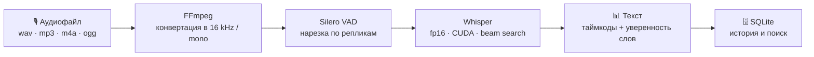

# Aviation Transcriber Pro ✈️

[](https://www.python.org/)
[](https://pytorch.org/)
[](https://huggingface.co/docs/transformers)
[](https://developer.nvidia.com/cuda-toolkit)
[](https://www.microsoft.com/windows/)

**Настольное приложение для автоматического распознавания авиационного радиообмена.**
Превращает записи переговоров пилотов и диспетчеров в текст с таймкодами и пословной оценкой достоверности — полностью локально, на вашем GPU, без передачи данных в облако.

---

## 📑 Содержание

- [✨ Возможности](#-возможности)
- [⚙️ Как это работает](#-как-это-работает)
- [🧰 Стек технологий](#-стек-технологий)
- [📋 Системные требования](#-системные-требования)
- [⬇️ Установка](#-установка)
- [🚀 Запуск](#-запуск)
- [🎛 Использование](#-использование)
- [📂 Структура проекта](#-структура-проекта)
- [🧪 Скрипты и обучение](#-скрипты-и-обучение)
- [🗄 База данных](#-база-данных)
- [🔧 Конфигурация](#-конфигурация)
- [❗ Решение проблем](#-решение-проблем)

---

## ✨ Возможности

- 🎙 **Высокоточная транскрибация** — распознавание сложной авиационной речи на фоне помех, шума каналов и перекрытий.
- 🧠 **Умное разделение диалога** — Silero VAD режет аудиопоток по естественным паузам, отделяя реплики диспетчера от реплик пилота.
- 📊 **Пословная уверенность** — каждое слово окрашивается по достоверности: 🟢 > 80 %, 🟡 50–80 %, 🔴 < 50 %.
- ⏱ **Таймкоды** — перед каждой репликой выводится метка `[MM:SS]` для быстрой навигации по записи.
- 💾 **Локальная обработка** — все вычисления идут на вашем CPU/GPU; интернет нужен только для скачивания моделей.
- 🎧 **Встроенный плеер** — прослушивание исходного аудио прямо в окне приложения.
- 🗄 **История расшифровок** — всё сохраняется в SQLite с поиском по имени файла и тексту, просмотром и удалением записей.
- 📋 **Один клик — и текст у вас** — копирование результата в буфер обмена.
- 🔄 **Переключение моделей** — любые локальные модели из папки `models/` выбираются прямо в интерфейсе.

---

## ⚙️ Как это работает



1. **Конвертация** — FFmpeg жёстко переводит любой входной файл в `WAV 16 kHz / mono`, стандартный формат для моделей распознавания речи.
2. **VAD-нарезка** — Silero VAD находит границы речи (`threshold = 0.3`, пауза ≥ 500 мс, запас по краям 300 мс), чтобы модель не «галлюцинировала» на тишине и шуме.
3. **Распознавание** — каждая реплика поочерёдно подаётся в Whisper (`fp16`, `cuda:0`, `num_beams = 4`, фиксированный язык `english`).
4. **Постобработка** — по токен-скорам (`compute_transition_scores`) считается достоверность каждого слова, текст собирается и печатается в окно в реальном времени.
5. **Сохранение** — готовая расшифровка с таймкодами записывается в базу данных.

<!-- 📸 Сюда можно вставить скриншот интерфейса:

-->

---

## 🧰 Стек технологий

| Категория | Технологии |
|---|---|
| Язык | Python 3.11 |
| GUI | [CustomTkinter](https://github.com/TomSchimansky/CustomTkinter) (тёмная тема) |
| ML / инференс | PyTorch 2.5.1 (CUDA 12.1), Hugging Face Transformers |
| VAD | [Silero VAD](https://github.com/snakers4/silero-vad) (загрузка через `torch.hub`) |
| Дообучение | PEFT / LoRA, Datasets, Accelerate |
| Аудио | FFmpeg, Pygame (плеер), Librosa / SoundFile |
| База данных | SQLite (стандартная библиотека `sqlite3`) |

---

## 📋 Системные требования

| Компонент | Требование |
|---|---|
| ОС | Windows 10/11 (x64) |
| Python | 3.11 |
| GPU | NVIDIA с поддержкой CUDA (модель загружается на `cuda:0` в `float16`) |
| Драйверы | NVIDIA Driver + CUDA Toolkit 12.1 |
| FFmpeg | установлен в `PATH` **или** лежит в папке `ffmpeg/bin/ffmpeg.exe` |
| Диск | ~1–2 ГБ на модель Whisper + место под записи расшифровок |

> ⚠️ Проект ориентирован на Windows и NVIDIA GPU: пути к `ffmpeg.exe` и устройство `cuda:0` зашиты в код. На CPU или Linux приложение потребует небольших правок (см. [Конфигурация](#-конфигурация)).

---

## ⬇️ Установка

### 1. Клонирование репозитория

```commandline
git clone https://github.com/Gaz1x/Aviation-Transcriber-Pro.git
cd Aviation-Transcriber-Pro
```

### 2. Виртуальное окружение *(рекомендуется)*

```commandline
python -m venv .venv
.venv\Scripts\activate
```

### 3. PyTorch с поддержкой CUDA 12.1

Устанавливайте **первым** и строго в указанной последовательности:

```commandline
pip install torch==2.5.1 torchvision torchaudio --index-url https://download.pytorch.org/whl/cu121
```

Если у вас уже есть локальный `.whl`-файл, можно поставить его напрямую:

```commandline
pip install "torch-2.5.1+cu121-cp311-cp311-win_amd64.whl" torchvision torchaudio --index-url https://download.pytorch.org/whl/cu121
```

Проверка:

```commandline
python -c "import torch; print(torch.__version__, torch.cuda.is_available())"
```

Должно вывести что-то вроде `2.5.1+cu121 True`.

### 4. Остальные зависимости

```commandline
pip install customtkinter transformers accelerate datasets peft pygame librosa soundfile numpy safetensors
```

### 5. FFmpeg

Скачайте сборку с [ffmpeg.org](https://ffmpeg.org/download.html) и сделайте одно из двух:

- добавьте папку `bin` в переменную среды `PATH`;
- либо положите `ffmpeg.exe` в директорию проекта по пути `ffmpeg/bin/ffmpeg.exe`.

### 6. Модели

Приложение подхватывает **каждую папку** внутри каталога `models/` как отдельную модель:

```text
models/
├── Aviation_Whisper_V2/      ← ваша обученная модель (пример)
├── aviation_whisper_v1_2/    ← и любые другие...
└── ...
```

- Если папка `models/` пуста — приложение автоматически использует `openai/whisper-small` с Hugging Face Hub.
- Готовые LoRA-адаптеры лежат в репозитории (`aviation_whisper_V1/`, `Aviation_Whisper_V2/`); соберите из них монолитную модель скриптом `scripts/create_standalone_model.py` и положите результат в `models/`.

---

## 🚀 Запуск

```commandline
python app.py
```

При старте приложение:
1. создаёт папки `models/` и `database/`, если их нет;
2. инициализирует базу данных SQLite;
3. загружает VAD и выбранную модель (индикатор внизу справа: `● Модель активна`).

Готово к работе, когда статус модели станет зелёным.

---

## 🎛 Использование

| Шаг | Действие |
|:---:|---|
| **1** | 📁 **Аудио** — выберите запись (`*.wav`, `*.mp3`, `*.m4a`, `*.ogg`). |
| **2** | 🎧 **Слушать** — при необходимости прослушайте файл (кнопка переключается в ⏹ **Стоп**). |
| **3** | ▶️ **Старт** — запустите транскрибацию; результат появляется в окне по мере распознавания. |
| **4** | 📋 **Копировать** — скопируйте текст в буфер обмена. |
| **5** | 🗄️ **История** — поиск, просмотр и удаление прошлых расшифровок. |

В окне **История** доступны:
- 🔍 поиск по имени файла и по тексту (в реальном времени);
- **Открыть** — полный текст расшифровки в отдельном окне;
- **Удалить** — удалить запись из базы.

---

## 📂 Структура проекта

```text
Aviation-Transcriber-Pro/
├── app.py                       # 🖥 Основное приложение (GUI + пайплайн)
├── database/
│   └── transcriptions.db        # 🗄 SQLite: история расшифровок
├── scripts/
│   ├── train_whisper.py         # 🎓 Дообучение Whisper (LoRA/QLoRA)
│   ├── retrain_whisper.py       # 🔄 Продолжение обучения с адаптера
│   ├── create_standalone_model.py  # 📦 Слияние LoRA в монолитную модель
│   └── test.py                  # 🧪 Консольный тест пайплайна
├── aviation_whisper_V1/         # 🧩 LoRA-адаптер, версия 1
├── Aviation_Whisper_V2/         # 🧩 LoRA-адаптер, версия 2 (PEFT)
├── models/                      # 🧠 Локальные модели (создаётся при запуске)
└── README.md
```

> 📁 Скрипты в `scripts/` используют пути относительно своей директории — запускайте их **из папки `scripts/`**.

---

## 🧪 Скрипты и обучение

| Скрипт | Назначение |
|---|---|
| `scripts/train_whisper.py` | Дообучение `openai/whisper-medium` методом LoRA (PEFT + QLoRA) на авиационном датасете. |
| `scripts/retrain_whisper.py` | Продолжение обучения поверх уже существующего адаптера (`../models/aviation_whisper_V1`). |
| `scripts/create_standalone_model.py` | Слияние весов LoRA-адаптера с базовой моделью (`merge_and_unload`) в автономную офлайн-модель. |
| `scripts/test.py` | Быстрая проверка конвейера (FFmpeg → VAD → Whisper) на конкретном аудиофайле без GUI. |

Типичный цикл дообучения:

```commandline
cd scripts
python train_whisper.py              # 1. обучение
python create_standalone_model.py    # 2. слияние адаптера в монолит
cd ..                                # 3. положить результат в models/ и запустить app.py
```

---

## 🗄 База данных

История хранится в `database/transcriptions.db` (SQLite, без внешних серверов):

```sql
CREATE TABLE IF NOT EXISTS history (
    id        INTEGER PRIMARY KEY AUTOINCREMENT,
    filename  TEXT,
    text      TEXT,
    timestamp DATETIME DEFAULT CURRENT_TIMESTAMP
);
```

Поиск выполняется по полям `filename` и `text` (`LIKE %запрос%`), сортировка — от новых записей к старым.

---

## 🔧 Конфигурация

Все ключевые параметры вынесены в начало `app.py`:

| Параметр | Значение по умолчанию | Описание |
|---|---|---|
| `FFMPEG_EXE` | `ffmpeg/bin/ffmpeg.exe` | Путь к исполняемому файлу FFmpeg |
| `MODELS_BASE_DIR` | `models` | Каталог с моделями |
| `DB_FILE` | `database/transcriptions.db` | Файл базы данных |
| `threshold` (VAD) | `0.3` | Чувствительность голосодетектора (ниже — ловит тише) |
| `min_silence_duration_ms` | `500` | Минимальная пауза для разделения реплик |
| `speech_pad_ms` | `300` | Запас тишины по краям реплики |
| `num_beams` | `4` | Ширина beam search при генерации |
| `repetition_penalty` | `1.1` | Штраф за повторения (смягчён, чтобы допускать повторы слов) |
| `language` | `english` | Фиксированный язык распознавания |

🎨 Палитра тёмной темы: фон `#121212`, панели `#1e1e1e`, акцент `#2fa572`.

---

## ❗ Решение проблем

| Симптом | Причина и решение |
|---|---|
| `● Ошибка ядра` при запуске | Не установлен CUDA, PyTorch собран без поддержки GPU или недостаточно видеопамяти. Проверьте `torch.cuda.is_available()`. |
| `Сбой загрузки: [Errno 2] ffmpeg.exe` | FFmpeg не найден — добавьте его в `PATH` или положите в `ffmpeg/bin/`. |
| `— Речь не обнаружена —` / «Сигнал отсутствует» | Запись слишком тихая или шумная — снизьте `threshold` в `process_audio()` (например, до `0.2`). |
| `CUDA out of memory` | Закройте другие программы с GPU или возьмите модель меньшего размера (`whisper-base`). |
| Пустой список моделей | В папке `models/` нет подпапок — приложение переключится на `openai/whisper-small` (нужен интернет при первом скачивании). |
| Некоторые слова красные 🔴 | Низкая уверенность модели: шумный канал или необычная фразеология. Проверьте фрагмент через 🎧 **Слушать**. |

---

## 🗺 Планы

- [ ] Поддержка CPU / MPS и других ОС без правок в коде
- [ ] Автодетект языка и распознавание русского радиообмена
- [ ] Экспорт расшифровки в `SRT` / `TXT` / `CSV`
- [ ] Пакетная обработка нескольких файлов
- [ ] Разделение говорящих (diarization)
- [ ] Определение позывных (callsign extraction)

---

## 🤝 Участие

Пул-реквесты, идеи и найденные баги приветствуются:

1. Fork → создайте ветку `feature/my-idea`
2. Внесите изменения
3. Откройте Pull Request с описанием сути и скриншотами (для правок UI)

---

## ✍️ Автор

**Gaz1x** — [@Gaz1x](https://github.com/Gaz1x)

Если проект вам пригодился — поставьте ⭐ на репозиторий, это мотивирует развивать его дальше.

> 📄 Лицензия на данный момент не указана. Для использования кода в своих проектах свяжитесь с автором.
